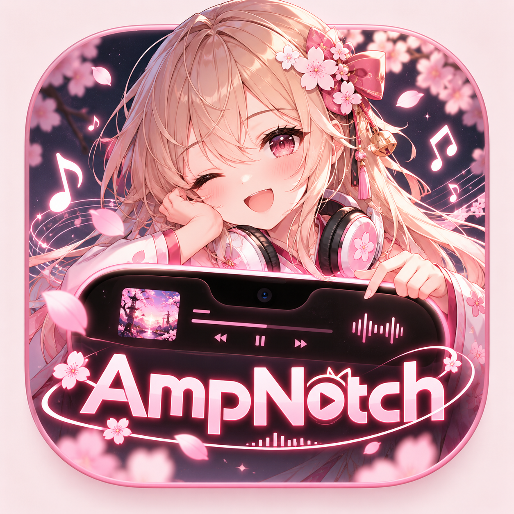

<div align="center">
  <p>
    
    &nbsp;&nbsp;
    
  </p>
  <h1>AmpNotch 🎧</h1>
  <p><strong>Your favorite music, a little closer ✨</strong></p>
  <p>A little space on your Mac for music, lyrics, and device alerts.<br>With customizable Liquid Glass to make it yours.</p>
  <p><strong>Version 1.2</strong> · macOS 13+ · Made by Ampsoria</p>
  <p>
    <a href="README.md"><kbd> ← 🇹🇭 ภาษาไทย </kbd></a> &nbsp;·&nbsp;
    <strong>🌐 English</strong>
  </p>
  <p>
    <a href="AmpNotch.dmg">📦 Download DMG</a> ·
    <a href="RELEASE_NOTES.md">🌷 Release notes</a> ·
    <a href="INTEGRATIONS.md">🔎 Integration details</a>
  </p>
</div>

---

## ✨ Meet AmpNotch

| Feature | What it does |
| :--- | :--- |
| 🎵 **Music controls** | View artwork and track details from Apple Music / Spotify, with play, pause, skip, seek, and shuffle controls. |
| 🌈 **Live waveform** | Six bars react to actual system audio, using colors from the artwork. Audio is processed locally without recording files or uploading audio. |
| 🫧 **Liquid Glass** | The collapsed notch stays black. Hover to expand it into glass, with Clear, Regular, and Classic Black options. |
| 🎤 **Synced lyrics** | Displays matching lyrics from LRCLIB, with scrolling that follows playback on the Lock Screen. |
| 🎧 **AirPods alerts** | Connection and nearby case-opening alerts, with case artwork in the album artwork position. |
| 🔋 **Compact alerts** | Small notifications for volume, charging, and Caps Lock. |
| 🧩 **Browser companion** | Control browser media through the Ampsoria Connected extension. |
| 🌙 **StandBy** | Music, time, battery, and weather, with configurable city and idle time. |
| 🔒 **Lock Screen · Experimental** | Artwork, controls, and lyrics while locked, retaining the macOS wallpaper, clock, and unlock flow. |

> 💡 Support varies by AirPods model and website. Lyrics depend on matching data being available from LRCLIB. See [integration details](INTEGRATIONS.md) for limitations and validation status.

## 💻 Requirements

| Item | Requirement |
| :--- | :--- |
| App runtime | macOS 13 or later |
| Included DMG | Apple Silicon Mac (arm64) |
| Live audio waveform | macOS 14.2+ and System Audio Recording permission |
| Apple Liquid Glass | macOS 26 or later; earlier versions use native blur |
| Building from source | Swift 6.2 and macOS SDK 26 |

The current package is **ad-hoc signed** and **not notarized**, so macOS may display a security check or warning when you first open it.

## 🚀 Get started

1. Download and open [AmpNotch.dmg](AmpNotch.dmg).
2. Drag **AmpNotch.app** into **Applications**, then launch it from there.
3. In **Set up AmpNotch**, enable only the features and permissions you want.
4. Start playback in a connected app or browser and enjoy your music 🎶

**Click or hover over the notch** to expand it, and **right-click** to open Settings. To exit, choose **Quit AmpNotch** from the menu bar or use the Quit button in Settings.

### 🔑 Choose your permissions

**Set up AmpNotch** appears automatically on first launch. You do not need to grant every permission.

| Setup button | Purpose |
| :--- | :--- |
| **Connect Apple Music / Spotify** | Opens the music app and requests Automation access to read track information and control playback. |
| **Enable live waveform** | Requests System Audio Recording access for the waveform on macOS 14.2+. |
| **Enable AirPods detection** | Requests Bluetooth access for case and connection detection. |
| **Allow microphone** | Used only for Shazam song recognition; not required for music playback or the waveform. |

If you previously denied access, choose **Open … settings** and enable the permission for AmpNotch in System Settings yourself. The app cannot grant permissions on your behalf.

Prefer to do this later? Choose **Done / Set up later**, then return through **Settings → Setup & permissions…** or the menu bar 🐾

## 🫧 Make it yours

In **Settings → Appearance**, choose a material for the expanded notch:

- **Clear** — Untinted glass on macOS 26.
- **Regular** — The standard glass appearance.
- **Classic Black** — A black background.

Adjust **Notch glass opacity** and **Lock Screen glass opacity** independently from **20–100%**. Changes apply immediately and persist after restarting, without reducing the clarity of artwork, text, or controls.

Choose **Restore glass defaults** to reset both values to **62%**. The collapsed notch remains black; glass appears when you hover to expand it.

## 🔒 Music on the Lock Screen

Enable **Settings → Lock Screen → Show music and lyrics when locked**, start playing music, then press **Control–Command–Q**.

Artwork and playback controls appear on the left, with synced lyrics on the right. Use **Preview** to check the layout without locking your Mac.

> 🧪 This feature is **experimental** because it uses private macOS APIs. Track information is visible while your Mac is locked. **StandBy** is a separate app window, not the secure macOS Lock Screen.

## 🧩 Connect browser media

Use **Ampsoria Connected** with Chrome, Edge, Brave, or Arc. The extension is not needed for the native Apple Music or Spotify apps on your Mac.

1. In AmpNotch Settings, choose **Extension folder**.
2. Copy the **BrowserExtension** folder into **Documents** and keep it in that location after installation.
3. Open your browser's extensions page → **Developer mode** → **Load unpacked**, then select the copied folder.
4. Choose **Copy browser pairing code** in AmpNotch, paste it into the extension popup, and select **Connect to AmpNotch**.
5. Open or reload a music/video page and start playback 🎵

The extension supports HTML media that the website exposes for control. Seeking and skipping depend on the website. It connects to the app through `127.0.0.1:9876` using a per-device pairing code and sends commands only to the selected tab. It does not mirror video.

📖 The [Thai extension setup guide](Resources/Extension%20Setup.txt) is also included at the root of the DMG and is available through **Settings → Extension setup guide** after installation.

## 🎨 Bring your own menu bar icon

Place your files in `Resources/`, then rebuild the app:

| File | Format |
| :--- | :--- |
| `AmpNotch_Menubar_icon.png` | Full-color artwork; takes priority over template icons when present. |
| `MenuBarIconTemplate.pdf` | Vector template icon. |
| `MenuBarIconTemplate.png` | Transparent template icon, with an optional matching `@2x` file. |

See the [menu bar icon guide](Resources/MenuBarIcon-README.md) for dimensions and instructions. Launch the rebuilt app to see your updated icon.

## 🛠️ Development

Build the app:

```sh
bash scripts/build.sh
```

Run the test suites:

```sh
bash scripts/test.sh
```

Package the latest build as a DMG:

```sh
bash scripts/package_release.sh --skip-build
```

Building Liquid Glass requires **Swift 6.2 + macOS SDK 26**, with a deployment target of macOS 13 or later. The build uses the host machine's architecture and is ad-hoc signed.

## 📚 More to explore

Supporting documents may be in Thai or English.

- 🌷 [Release notes and validation status](RELEASE_NOTES.md)
- 🔎 [Integrations and feature limitations](INTEGRATIONS.md)
- 🧩 [Extension setup guide (Thai)](Resources/Extension%20Setup.txt)
- 🎨 [Menu bar icon guide](Resources/MenuBarIcon-README.md)
- 📄 [License terms](Resources/LICENSE.txt)

---

<div align="center">
  <p>Made with 🎧 by <a href="https://github.com/Ampsoria">Ampsoria</a></p>
  <p>Copyright © 2026 Ampsoria. All rights reserved.</p>
</div>
