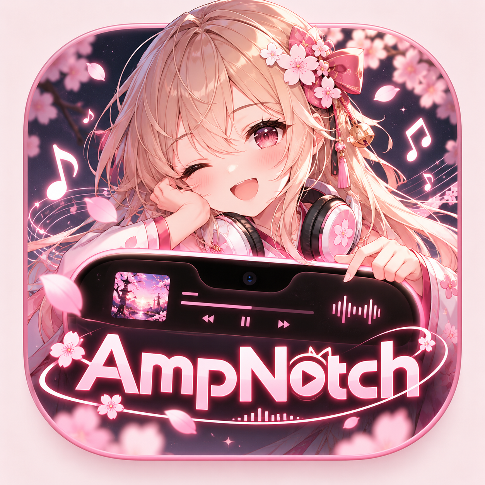

<div align="center">
  <p>
    
    &nbsp;&nbsp;
    
  </p>
  <h1>AmpNotch 🎧</h1>
  <p><strong>เพลงโปรดอยู่ใกล้ขึ้นอีกนิด ✨</strong></p>
  <p>เปลี่ยน notch บน Mac ให้เป็นพื้นที่เล็ก ๆ สำหรับเพลง เนื้อเพลง และการแจ้งเตือนอุปกรณ์<br>พร้อมกระจก Liquid Glass ที่ปรับให้เข้ากับคุณได้</p>
  <p><strong>เวอร์ชัน 1.2</strong> · macOS 13+ · สร้างโดย Ampsoria</p>
  <p>
    <strong>🇹🇭 ภาษาไทย</strong> &nbsp;·&nbsp;
    <a href="README.en.md"><kbd> 🌐 English → </kbd></a>
  </p>
  <p>
    <a href="AmpNotch.dmg">📦 ดาวน์โหลด DMG</a> ·
    <a href="RELEASE_NOTES.md">🌷 อัปเดตล่าสุด</a> ·
    <a href="INTEGRATIONS.md">🔎 รายละเอียดการรองรับ</a>
  </p>
</div>

---

## ✨ มีอะไรให้เล่นบ้าง

| ฟีเจอร์ | รายละเอียด |
| :--- | :--- |
| 🎵 **ควบคุมเพลง** | ดูปกและชื่อเพลงจาก Apple Music / Spotify พร้อมเล่น หยุด ข้ามเพลง เลื่อนเวลา และ shuffle |
| 🌈 **กราฟเสียงสด** | กราฟหกแท่งขยับตามเสียงระบบจริง เลือกสีจากปกเพลง ประมวลผลในเครื่องโดยไม่บันทึกหรืออัปโหลดเสียง |
| 🫧 **Liquid Glass** | notch ตอนย่อเป็นสีดำ ชี้เมาส์เพื่อขยายเป็นกระจก เลือก Clear, Regular หรือ Classic Black ได้ |
| 🎤 **เนื้อเพลงซิงก์ตามเสียง** | แสดงเนื้อเพลงจาก LRCLIB เมื่อพบข้อมูลตรงกับเพลง พร้อมเลื่อนตามเวลาเพลงบน Lock Screen |
| 🎧 **แจ้งเตือน AirPods** | แจ้งการเชื่อมต่อและตรวจการเปิดเคสใกล้เครื่อง พร้อมภาพเคสในตำแหน่งปกเพลง |
| 🔋 **แจ้งเตือนขนาดกะทัดรัด** | การแจ้งเตือน Volume, Charging และ Caps Lock ขนาดกะทัดรัด |
| 🧩 **ส่วนขยายเบราว์เซอร์** | ควบคุมเพลงจากเบราว์เซอร์ผ่านส่วนขยาย Ampsoria Connected |
| 🌙 **StandBy** | แสดงเพลง เวลา แบตเตอรี่ และสภาพอากาศ พร้อมตั้งเมืองและเวลา idle ได้ |
| 🔒 **หน้าจอล็อก · รุ่นทดลอง** | แสดงปก แผงควบคุม และเนื้อเพลงขณะล็อก โดยใช้วอลเปเปอร์ นาฬิกา และการปลดล็อกเดิมของ macOS |

> 💡 AirPods แต่ละรุ่นและเว็บไซต์แต่ละแห่งอาจรองรับไม่เท่ากัน ส่วนเนื้อเพลงขึ้นอยู่กับข้อมูลที่ LRCLIB มี ดูข้อจำกัดและสถานะการทดสอบใน [รายละเอียด integration](INTEGRATIONS.md)

## 💻 ก่อนติดตั้ง

| รายการ | ความต้องการ |
| :--- | :--- |
| ใช้งานแอป | macOS 13 ขึ้นไป |
| DMG ที่แนบในโปรเจกต์ | Mac ที่ใช้ Apple Silicon (arm64) |
| กราฟเสียงจริง | macOS 14.2+ และสิทธิ์ System Audio Recording |
| Apple Liquid Glass | macOS 26 ขึ้นไป; รุ่นเก่าใช้ native blur |
| Build จากซอร์ส | Swift 6.2 และ macOS SDK 26 |

แพ็กเกจปัจจุบันเซ็นแบบ **ad-hoc** และยังไม่มี **notarization** จึงอาจมีการตรวจสอบหรือแจ้งเตือนจาก macOS เมื่อเปิดครั้งแรก

## 🚀 เริ่มใช้งาน

1. ดาวน์โหลดและเปิด [AmpNotch.dmg](AmpNotch.dmg)
2. ลาก **AmpNotch.app** ไปไว้ใน **Applications** แล้วเปิดแอปจากที่นั่น
3. ในหน้า **Set up AmpNotch** เลือกเปิดเฉพาะฟีเจอร์และสิทธิ์ที่ต้องการ
4. เปิดเพลงจากแอปหรือเบราว์เซอร์ที่เชื่อมไว้ แล้วเพลิดเพลินกับเพลงโปรดได้เลย 🎶

**คลิกหรือชี้ที่ notch** เพื่อขยาย และ **คลิกขวา** เพื่อเปิด Settings เมื่อต้องการเลิกใช้งาน เลือก **Quit AmpNotch** จากเมนูบาร์หรือปุ่ม Quit ใน Settings

### 🔑 สิทธิ์ที่เลือกเปิดได้

หน้า **Set up AmpNotch** จะแสดงอัตโนมัติเมื่อเปิดครั้งแรก ไม่จำเป็นต้องเปิดทุกสิทธิ์

| ปุ่มในหน้าตั้งค่า | ใช้ทำอะไร |
| :--- | :--- |
| **Connect Apple Music / Spotify** | เปิดแอปเพลงและขอ Automation เพื่ออ่านข้อมูลและควบคุมเพลง |
| **Enable live waveform** | ขอ System Audio Recording สำหรับกราฟเสียงบน macOS 14.2+ |
| **Enable AirPods detection** | ขอ Bluetooth สำหรับตรวจเคสและการเชื่อมต่อ |
| **Allow microphone** | ใช้ค้นหาเพลงด้วย Shazam เท่านั้น ไม่จำเป็นสำหรับฟังเพลงหรือกราฟเสียง |

ถ้าเคยกดไม่อนุญาต ให้กด **Open … settings** แล้วเปิดสิทธิ์ให้ AmpNotch ใน System Settings ด้วยตัวเอง แอปไม่สามารถกดอนุญาตแทนคุณได้

จะตั้งค่าทีหลังก็ได้: กด **Done / Set up later** แล้วกลับมาที่ **Settings → Setup & permissions…** หรือเมนูบาร์ 🐾

## 🫧 ปรับหน้าตาให้ถูกใจ

ใน **Settings → Appearance** เลือกวัสดุของ notch ตอนขยายได้:

- **Clear** — กระจกใสไม่มี tint บน macOS 26
- **Regular** — กระจกแบบมาตรฐาน
- **Classic Black** — พื้นหลังสีดำ

ปรับ **Notch glass opacity** และ **Lock Screen glass opacity** แยกกันได้ตั้งแต่ **20–100%** เห็นผลทันทีและจำค่าหลังเปิดแอปใหม่ โดยไม่ลดความชัดของปก ข้อความ หรือปุ่ม

กด **Restore glass defaults** เพื่อคืนความทึบทั้งสองค่าเป็น **62%** ส่วน notch ตอนย่อยังคงเป็นสีดำ และจะใช้กระจกเมื่อชี้เมาส์ให้ขยายเท่านั้น

## 🔒 เพลงบน Lock Screen

เปิด **Settings → Lock Screen → Show music and lyrics when locked** แล้วเล่นเพลงและกด **Control–Command–Q**

ปกเพลงและแผงควบคุมอยู่ด้านซ้าย ส่วนเนื้อเพลงที่ซิงก์อยู่ด้านขวา มีปุ่ม **Preview** ให้ดูการจัดวางโดยไม่ต้องล็อกเครื่อง

> 🧪 ฟีเจอร์นี้ยังเป็น **รุ่นทดลอง (experimental)** เพราะใช้ API ภายใน macOS และข้อมูลเพลงจะมองเห็นได้ขณะล็อก ส่วน **StandBy** เป็นหน้าต่างของแอป ไม่ใช่หน้าล็อกปลอดภัยของระบบ

## 🧩 เชื่อมเพลงจากเบราว์เซอร์

ใช้ส่วนขยาย **Ampsoria Connected** กับ Chrome, Edge, Brave หรือ Arc หากใช้ Apple Music / Spotify แบบแอปบน Mac ไม่ต้องติดตั้งส่วนขยาย

1. ใน Settings ของ AmpNotch กด **Extension folder**
2. คัดลอกโฟลเดอร์ **BrowserExtension** ไปไว้ใน **Documents** และเก็บไว้ที่เดิมหลังติดตั้ง
3. เปิดหน้าจัดการ extensions ในเบราว์เซอร์ → **Developer mode** → **Load unpacked** แล้วเลือกโฟลเดอร์ที่คัดลอกไว้
4. กด **Copy browser pairing code** ใน AmpNotch แล้ววางใน popup ของส่วนขยาย จากนั้นกด **Connect to AmpNotch**
5. เปิดหรือรีโหลดหน้าเล่นเพลง/วิดีโอ แล้วเริ่มเล่นเพลง 🎵

รองรับ HTML media ที่เว็บไซต์เปิดให้ควบคุม การเลื่อนเวลาและข้ามเพลงขึ้นอยู่กับเว็บไซต์ ส่วนขยายเชื่อมกับแอปผ่าน `127.0.0.1:9876` ด้วยรหัสจับคู่แยกแต่ละเครื่อง และส่งคำสั่งไปเฉพาะแท็บที่เลือก ไม่มีการ mirror ภาพวิดีโอ

📖 [คู่มือติดตั้งส่วนขยายภาษาไทย](Resources/Extension%20Setup.txt) มีให้ในหน้าแรกของ DMG ด้วย และเปิดได้จาก **Settings → Extension setup guide** หลังติดตั้ง

## 🎨 ใช้ไอคอนเมนูบาร์ของคุณเอง

ใส่ไฟล์ใน `Resources/` แล้ว build แอปใหม่:

| ไฟล์ | รูปแบบ |
| :--- | :--- |
| `AmpNotch_Menubar_icon.png` | ไอคอนสี ใช้ก่อน template หากมีไฟล์นี้ |
| `MenuBarIconTemplate.pdf` | ไอคอน template แบบ vector |
| `MenuBarIconTemplate.png` | ไอคอน template พื้นหลังโปร่งใส รองรับไฟล์ `@2x` คู่กัน |

ดูขนาดไฟล์และขั้นตอนใน [คู่มือไอคอนเมนูบาร์](Resources/MenuBarIcon-README.md) เปลี่ยนไฟล์แล้วต้องเปิดแอปรุ่นที่ build ใหม่จึงจะเห็นไอคอนใหม่

## 🛠️ สำหรับนักพัฒนา

สร้างแอป:

```sh
bash scripts/build.sh
```

รันชุดทดสอบ:

```sh
bash scripts/test.sh
```

สร้าง DMG จาก build ล่าสุด:

```sh
bash scripts/package_release.sh --skip-build
```

ใช้ **Swift 6.2 + macOS SDK 26** เพื่อ build Liquid Glass โดยตั้งเป้าหมาย runtime เป็น macOS 13 ขึ้นไป ตัว build ใช้สถาปัตยกรรมของเครื่องที่ build และเซ็นแบบ ad-hoc

## 📚 อ่านเพิ่มเติม

- 🌷 [บันทึกการอัปเดตและสถานะการตรวจสอบ](RELEASE_NOTES.md)
- 🔎 [การเชื่อมต่อและข้อจำกัดของฟีเจอร์](INTEGRATIONS.md)
- 🧩 [คู่มือติดตั้งส่วนขยาย](Resources/Extension%20Setup.txt)
- 🎨 [คู่มือไอคอนเมนูบาร์](Resources/MenuBarIcon-README.md)
- 📄 [เงื่อนไขการใช้งาน](Resources/LICENSE.txt)

---

<div align="center">
  <p>สร้างด้วยใจและเสียงเพลง 🎧 โดย <a href="https://github.com/Ampsoria">Ampsoria</a></p>
  <p>ลิขสิทธิ์ © 2026 Ampsoria สงวนลิขสิทธิ์</p>
</div>
